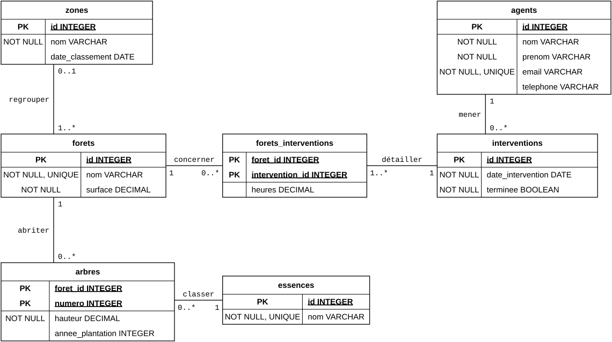
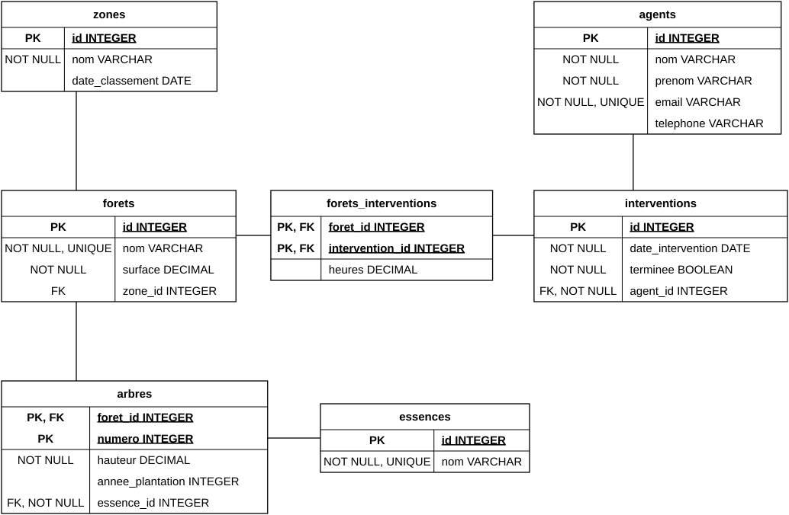

# Corrigé · Examen type ModelDon (Gestion des forêts)

## Partie 1 : Modèle conceptuel (MCD) · 15 points

### Question 1.1 · 12 points

{.diagramme}

Les noms de relation sont libres, tant que ce sont des verbes à l'infinitif. `heures` se pose sur la relation `concerner`, qu'elle décrit. `essence` reste un attribut de `arbres` : sa table de référence vient au MLD.

| Critère | Points |
|---|---|
| 5 entités : `zones`, `forets`, `arbres`, `agents`, `interventions` (0,5 par entité) | 2,5 |
| Attributs complets, dont `essence` et `heures`, types cohérents (`DECIMAL` pour la surface, `BOOLEAN` pour `terminee`, `DATE` pour les dates) | 2,5 |
| Identifiants : une `PK` par entité, les deux `PK` de `arbres` | 2 |
| Relations : un trait, un verbe à l'infinitif (0,5 par relation) | 2,5 |
| Multiplicités correctes et bien placées (0,5 par relation) | 2,5 |

Accepter aussi une entité associative `forets_interventions` qui porte `heures`, ou une entité `essences` reliée à `arbres`. Ne pas pénaliser les `NOT NULL` et `UNIQUE`, qui ne sont pas attendus.

### Question 1.2 · 3 points

a) Entité faible : le numéro repart à 1 dans chaque forêt, il faut donc la forêt et le numéro pour identifier un arbre.

b) Entité associative : le nombre d'heures ne tient ni dans la forêt ni dans l'intervention, il décrit leur lien. Dans le MCD, `heures` se pose sur la relation `concerner`.

c) Non : c'est un attribut dérivé. Il se calcule et ne se stocke pas, sinon il devient faux au prochain arbre recensé.

## Partie 2 : Modèle logique (MLD) et normalisation · 20 points {.nouvelle-page}

### Question 2.1 · 11 points

{.diagramme}

En violet, la table de liaison de la relation N:M. En vert, la table de référence du champ à texte libre `essence`. `forets_interventions` peut porter un autre nom.

| Critère | Points |
|---|---|
| `zone_id` dans `forets`, sans `NOT NULL` | 2 |
| `agent_id` dans `interventions`, avec `NOT NULL` | 2 |
| `essences` : table de référence du champ à texte libre `essence`, `essence_id` dans `arbres`, avec `NOT NULL` | 1 |
| `arbres` : `PK` composite `foret_id`, `numero`, et `foret_id` aussi en `FK` | 2 |
| `forets_interventions` : table de liaison de la relation N:M, deux `PK, FK`, plus `heures` | 3 |
| `NOT NULL` et `UNIQUE` tirés du besoin (`nom` et `email` uniques, `surface` et `hauteur` obligatoires) | 1 |

### Question 2.2 · 9 points {.nouvelle-page}

Pour chaque table : 1 point pour la forme normale, 1 point pour la raison, 1 point pour la correction.

#### Table A · 3NF

`chef_secteur` dépend de `secteur_id`, une colonne hors clé.

::: cote
`agents`

| id | nom | secteur_id |
|---|---|---|
| 1 | Martin | 2 |
| 2 | Rossi | 2 |
| 3 | Weber | 5 |

`secteurs`

| id | chef |
|---|---|
| 2 | Keller |
| 5 | Dubois |
:::

#### Table B · 1NF

Une case contient une liste. C'est une relation N:M oubliée.

`sentiers`

| id | nom | commune |
|---|---|---|
| 1 | Crêtes | Vallorbe |
| 1 | Crêtes | Ballaigues |
| 2 | Source | Orbe |

Chaque valeur sur sa ligne, avec pour clé le couple `id`, `commune`. Comme au cours, `nom` se répète alors et la 2NF le corrige. Accepter aussi la décomposition directe en `sentiers` et `sentiers_communes`.

#### Table C · 2NF

La clé est le couple, or `nom_outil` ne dépend que de `outil_id`.

::: cote
`outils_interventions`

| outil_id | intervention_id | quantite |
|---|---|---|
| 1 | 10 | 2 |
| 1 | 11 | 1 |
| 2 | 10 | 3 |

`outils`

| id | nom |
|---|---|
| 1 | Tronçonneuse |
| 2 | Hache |
:::

## Partie 3 : Modèle physique (MPD) · 30 points {.nouvelle-page}

Le script complet, testé sur SQLite, se télécharge ici : [corrige-forets.sql](https://github.com/romanoe/comem-modeldon/blob/main/revisions/corrige-forets.sql).

### Question 3.1 · 20 points

```sql
CREATE TABLE forets (
  id INTEGER PRIMARY KEY,
  nom TEXT NOT NULL UNIQUE,
  surface REAL NOT NULL CHECK (surface > 0),
  zone_id INTEGER
    REFERENCES zones(id)
    ON DELETE SET NULL
);

CREATE TABLE interventions (
  id INTEGER PRIMARY KEY,
  date_intervention TEXT NOT NULL,
  terminee INTEGER NOT NULL DEFAULT 0
    CHECK (terminee IN (0, 1)),
  agent_id INTEGER NOT NULL
    REFERENCES agents(id)
    ON DELETE RESTRICT
);

CREATE TABLE forets_interventions (
  foret_id INTEGER NOT NULL
    REFERENCES forets(id)
    ON DELETE RESTRICT,
  intervention_id INTEGER NOT NULL
    REFERENCES interventions(id)
    ON DELETE CASCADE,
  heures REAL CHECK (heures > 0),
  PRIMARY KEY (foret_id, intervention_id)
);
```

| Table | Critère | Points |
|---|---|---|
| `forets` | `nom TEXT NOT NULL UNIQUE` | 1 |
| | `surface REAL NOT NULL CHECK (surface > 0)` | 2 |
| | `zone_id` sans `NOT NULL`, `REFERENCES`, `ON DELETE SET NULL` | 2 |
| | Forme générale : `id INTEGER PRIMARY KEY`, virgules, point-virgule | 1 |
| `interventions` | `date_intervention TEXT NOT NULL` | 1 |
| | `terminee INTEGER`, `DEFAULT 0`, `CHECK (terminee IN (0, 1))` | 3 |
| | `agent_id NOT NULL`, `REFERENCES`, refus de suppression | 2 |
| `forets_interventions` | `foret_id NOT NULL`, `REFERENCES`, refus de suppression | 2 |
| | `intervention_id NOT NULL`, `REFERENCES`, `ON DELETE CASCADE` | 2 |
| | `heures REAL CHECK (heures > 0)`, sans `NOT NULL` | 1 |
| | `PRIMARY KEY (foret_id, intervention_id)` après les colonnes | 3 |

### Question 3.2 · 6 points

a) 1 point pour le `PRAGMA`, 2 points pour les `DROP` dans un ordre valide. Toute table doit disparaître avant celle qu'elle référence.

```sql
PRAGMA foreign_keys = ON;

DROP TABLE IF EXISTS forets_interventions;
DROP TABLE IF EXISTS interventions;
DROP TABLE IF EXISTS arbres;
DROP TABLE IF EXISTS forets;
DROP TABLE IF EXISTS agents;
DROP TABLE IF EXISTS essences;
DROP TABLE IF EXISTS zones;
```

b) Accepter tout ordre où le parent précède l'enfant, par exemple :

1. `zones`
2. `essences`
3. `agents`
4. `forets`
5. `arbres`
6. `interventions`
7. `forets_interventions`

c) `.read forets.sql`

### Question 3.3 · 4 points

```sql
ALTER TABLE agents DROP COLUMN telephone;

ALTER TABLE agents ADD COLUMN date_engagement TEXT;

ALTER TABLE arbres RENAME COLUMN hauteur TO hauteur_m;

ALTER TABLE essences RENAME TO especes;
```

## Syntaxe couverte par la partie 3

| Syntaxe du cours 04 | Vérifiée par |
|---|---|
| `INTEGER`, `REAL`, `TEXT`, `DATE` en `TEXT`, `BOOLEAN` en `0` ou `1` | 3.1 |
| `PRIMARY KEY` simple et composite | 3.1 |
| `NOT NULL`, `UNIQUE`, `DEFAULT`, `CHECK` | 3.1 |
| `REFERENCES` | 3.1 |
| `ON DELETE RESTRICT`, `CASCADE`, `SET NULL` | 3.1 |
| `PRAGMA foreign_keys = ON`, `DROP TABLE IF EXISTS` | 3.2 a |
| Ordre de création et ordre de suppression | 3.2 a et b |
| `.read` | 3.2 c |
| `ALTER TABLE` : `DROP COLUMN`, `ADD COLUMN`, `RENAME COLUMN`, `RENAME TO` | 3.3 |

## Partie 4 : QCM · 15 points

| N° | Réponse | Justification | Cours |
|---|---|---|---|
| 1 | c | Une décision tirée de l'information. `14` est une donnée, b une information | 01 |
| 2 | b | La réponse a décrit l'entité associative, la réponse d l'entité forte | 02 |
| 3 | d | Chaque information mérite sa colonne | 02 |
| 4 | a | Un attribut dérivé devient faux dès la prochaine saisie | 02 |
| 5 | c | Placement UML : la multiplicité collée à `reseaux` compte les réseaux d'un sentier | 02 |
| 6 | d | La table du côté `0..*` reçoit la clé | 03 |
| 7 | b | Bout parent `0..1` : la `FK` peut rester vide | 03 |
| 8 | a | `0..*` ou `1..*` aux deux bouts : table de liaison | 03 |
| 9 | c | Un nom recopié n'est pas une référence : rien n'interdit un nom inexistant | 03 |
| 10 | d | Une `FK` porte la clé primaire d'une autre table | 03 |
| 11 | b | Champ à texte libre : chaque valeur saisie une seule fois | 03 |
| 12 | a | `NOT NULL` pour obligatoire, `CHECK` pour positive. `DEFAULT 0` viole la condition | 04 |
| 13 | c | Le MLD reste indépendant du SGBD, le MPD lui est propre | 03, 04 |
| 14 | b | La suppression du sentier échouerait sur `NOT NULL` | 04 |
| 15 | d | Il faut recréer la table | 04 |
